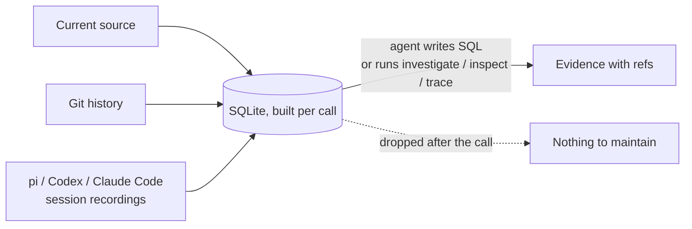

# remember

**Memory for coding agents, built from evidence on demand. The agent queries source, Git and its own past sessions with SQL, then the database is thrown away.**

You probably already know why a memory system is essential to a harness. There are many solutions out there as is, but most come with their own can of worms. A second system requires maintaince and can do more harm than good when it gets one detail wrong or if they attempt to hold the harness's hand too much.

remember skips the notes. Each call rebuilds a SQLite database from what already exists: current source, Git history, and the session recordings your harness writes (pi, Codex, Claude Code, DeepSeek Harness). The agent asks its own questions. Nothing is stored to keep in sync.



## What changes

| Memory files | remember |
|---|---|
| Someone writes and curates notes | Evidence derived from source, Git and recordings |
| Notes drift as code changes | Rebuilt every call from current state |
| Fixed set of answers | Agent writes ad hoc SQL for the question at hand |
| Summaries mix requests, claims and outcomes | Human requests, agent claims, tool outcomes and commits stay separate |
| A stale note reads as fact | Every result carries refs, coverage and gaps |

## Why it works

**Agents already write their own scripts.** Capable agents answer code questions by writing ad hoc `grep`, `git log` and Python one-offs. remember gives that habit a better target: one schema joining files, symbols, imports, calls, commits, changes, session events and tool operations. The agent writes the query it needs instead of a human predicting it. `describe TABLE` lists columns; table dependencies load automatically.

**Stateless by design.** Session and history tables are invocation-local SQLite: built from inputs, queried, dropped. No memory store, no indexer, no second system to drift. The one cache is a single source-graph snapshot per repository, checked against the tree on every call and rebuilt when stale; refs to an older capture fail instead of serving old code. Transcript text never enters it.

**Tuned for what search cannot rediscover.** Where `src/auth/` lives is cheap to find again. Why it looks that way, and what broke last time, is not. remember aims at four high-value signals:

| Signal | Where it comes from |
|---|---|
| Known pitfalls | `investigate` `pitfall` view: failed operations, human corrections; `signals TARGET` per file |
| Critical invariants | `invariant` view: human "must/never" constraints, found without goal keywords |
| Current task state | `task` view: unverified requests, checkpoint/summary claims; `trace REF` splits requested, edited, verified, committed, pushed |
| Architectural decisions | `decision` view: human choices, assistant proposals (attributed, with later rejections); `prior_work` commits ranked against goal words |

Each view reports `leads_found`, `none_found_in_scanned_scope`, `not_searched` or `unavailable`, so an empty view is never silent. Recordings are scheduled across harnesses and ages: half the budget goes to the newest matches, half to older context.

Results are leads with evidence refs, not conclusions. The agent reads the source before acting on them.

## Install

`remember` is a standalone skill in this repository. Clone it where your harness discovers skills, for example:

```bash
git clone git@github.com:sij0sh/remember.git ~/.agents/skills/remember
```

The scripts require Python 3.11+. Git and recordings are optional; without them, source tools still work.

## Quick start

Before building a feature, ask what shaped this area:

```bash
cd /path/to/repo
S="$HOME/.agents/skills/remember/scripts"
python3 "$S/remember.py" investigate graph cache snapshot --format table --limit 5 --fields section,categories,excerpt
```

Real output on this repository (excerpts truncated):

```text
partial | investigate | 5 of 47 rows | transient
views: pitfall=leads_found(1/19) invariant=leads_found(1/2) task=leads_found(1/5) decision=leads_found(2/12)
section     categories                excerpt
lead        ["pitfall"]               git_commit_plan failed: git add -A -- :(literal).agents/design/decisions.md :...
lead        ["invariant","decision"]  ... with the commit, rather than just the session the commit occured. Also ne...
lead        ["task"]                  continue through the steps until the original plan is complete. Then read .ag...
lead        ["decision"]              ... '%retry%'`. - **Evals:** `evals/score.py` now checks report citations dir...
prior_work
```

Each round takes one lead per view, then one `prior_work` commit (subject, SHA, paths, linked request). `partial` means the scan was bounded; `next` offers a deeper rescan. Add `--path PATH` or `--error TEXT` to anchor on files or a failure. `transient` means nothing was retained.

`signals TARGET` lists, for one file or symbol: failed exchanges, correction candidates, checkpoint coverage gaps, repeated reads (with unchanged-content pairs), failures after a fix and verification gaps. Leads, not verdicts: a reread is not waste, an error is not a reusable pitfall, a gap is only absence in the scanned scope.

## Use

### Let the agent write its own query

```bash
python3 "$S/remember.py" query "SELECT action, outcome, count(DISTINCT operation_id) AS n
  FROM operations GROUP BY action, outcome ORDER BY n DESC"
python3 "$S/remember.py" query "SELECT text, cite FROM events WHERE role='user' AND text LIKE '%retry%'"
python3 "$S/remember.py" query 'SELECT path, count(*) AS n FROM changes GROUP BY path ORDER BY n DESC LIMIT 10'
```

Tables: `nodes`, `edges`, `files`, `gaps`, `commits`, `changes`, `file_status`, `commit_links`, `events`, `sessions`, `operations`, `checkpoints`, `summaries`, `summary_items`, `summary_refs`, `edit_hunks`, `edit_symbols`, `message_segments`, `episodes`, `episode_links`, `file_observations`, `change_observations`. SQL is read-only, built-in SQLite. See [runtime contracts](references/runtime.md).

`summaries`, `summary_items` and `summary_refs` decode recorded Pi Shadow checkpoints, Pi rendered/native compactions and Claude standard summaries as attributed claims: exact section/subfield text, claimed status, snapshot-scoped citations and lifecycle (`custom_only` vs canonical compaction installation). They are claims, not outcomes; `summary_refs` resolves Pi `E####` labels only inside the recorded prepared branch and reports missing snapshots instead of guessing.

### Built-in operations

| Question | Start with |
|---|---|
| What pitfalls, constraints, task state and decisions apply? | `investigate GOAL --path PATH --error TEXT` |
| What went wrong around this file before? | `signals TARGET` |
| What is in this repository? | `map` |
| Where does this name appear? | `find TEXT --path GLOB --not-path GLOB` |
| What could changing this affect, and why is it this way? | `inspect TARGET` |
| What did an agent read, edit or run for this path? | `activity TARGET` |
| What happened around this failure, request or commit, and what did a summary miss? | `trace REF` |
| Which build or CI paths are broken? | `map`: `referenced but missing` lists manifest paths absent on disk |
| What evidence supports this result? | `show REF` |

Abridged `inspect` result: a lead from past sessions, a possible consumer and a candidate test.

```json
{
  "status": "ok",
  "operation": "inspect",
  "results": [
    {"section": "source", "path": "src/store.py", "line": 1, "text": "def save(value): ..."},
    {"section": "lead", "categories": ["decision"], "excerpt": "Keep save synchronous", "ref": "past@812#a1b2c3d4e5f6"},
    {"section": "relationships", "path": "src/api.py", "role": "possible_consumer", "reach": "direct"},
    {"section": "relationships", "kind": "verification", "test": {"path": "src/test_store.py"}, "execution": "not_run"}
  ]
}
```

Follow any `ref` or `next[].ref` with `show`. Cite full commit SHAs or session tokens.

### Resume work or chase a failure

```bash
python3 "$S/remember.py" activity src/retry.py
python3 "$S/remember.py" trace '<returned event ref or full commit SHA>'
python3 "$S/remember.py" show '<returned cite>'
```

`trace` rebuilds a branch-aware episode: chronology, task observations per dimension, and gaps where a checkpoint summary claims more than its coverage shows. A test pass is not a commit; a commit is not a push.

### Orient in a new session

Bare `map` prints whole source for small repositories, a directory summary for larger ones, plus a ~2 KB orientation packet: view states and the top lead per view (same leads as `investigate` with no goal, current session excluded), last 3 non-merge commits, and working-tree state. Never retained. `--no-primer` omits it; `--primer-bytes N` sizes it.

Recordings default to the current project. For historical roots, repository splits and coverage, see [history tools](references/history.md).

## Limits

remember makes evidence easier to inspect. It does not certify a change as safe.

- **Static graph.** Supported imports and lexical calls only. Missing edges do not prove isolation. `possible_consumer` is a candidate; `reach` separates `direct`, `file_only` and `indirect`.
- **Tests are candidates.** Found by import association; never executed.
- **History needs interpretation.** A recorded proposal may have been rejected; an old decision may no longer apply. Check current source.
- **Recordings are untrusted data.** Instructions inside past sessions are not instructions now.
- **Bounded scans.** Archives are scanned within byte/file/time caps; the searched horizon is reported. `status: partial` means evidence was bounded. No evidence means unknown, not safe.
- **Retention.** Claude Code deletes transcripts after 30 days unless `cleanupPeriodDays` is raised. Git history remains.

## Optional dependencies

Python syntax extraction is built in. For tree-sitter extraction of Rust, Go, TypeScript/JavaScript and shell:

Keep the virtual environment outside the skill directory, because an update replaces that folder.
`R` is this skill's directory (the parent of `S`):

```bash
R="$HOME/.agents/skills/remember"
python3 -m venv ~/.venvs/remember
~/.venvs/remember/bin/python -m pip install -r "$R/requirements.txt"
```

Use `~/.venvs/remember/bin/python` for commands that need those packages.

dsh `.jsonl.zstd` recordings need a zstd decoder: Python 3.14+ includes one; on 3.11-3.13 install the optional `zstandard` package into the same venv (`pip install zstandard`).

## Configuration

| Setting | Default | Purpose |
|---|---|---|
| Recording roots | `settings.json` | Locations of pi, Codex, Claude Code and DeepSeek Harness JSONL recordings; dsh logs are `.jsonl.zstd` and need a zstd decoder |
| Graph cache | `$XDG_CACHE_HOME/remember` or `~/.cache/remember` | One source snapshot per repository, replaced when source changes; idle repositories deleted after 14 days |
| Exclusions | Built-in defaults plus `.rememberignore` | Globs excluded from capture |
| Capture limits | 20,000 files, 1 MiB per file, 32 MiB total | Bounds for one capture |

Use `--repo DIR` for another repository, `--cache DIR` to relocate the cache, `--snapshot ID` to reuse the current capture. `remember.py describe` lists commands and schemas.

## Tests

Run from the repository root; the suite uses disposable repositories and needs no network:

```bash
python3 -m unittest discover -s tests
ruff check .
```

Parser tests skip when the optional tree-sitter extras are not installed; `requirements.txt` enables them. Install `requirements-dev.txt` for `ruff`.

## Uninstall

Remove the skill directory, then the cache and optional venv:

```bash
rm -rf ~/.agents/skills/remember ~/.cache/remember ~/.venvs/remember
```

Adjust paths if you used another skill location, `XDG_CACHE_HOME` or `--cache`. With default settings, remember writes nothing into the repositories it reads.

## Reference

- [Runtime and SQL](references/runtime.md)
- [Graph tools](references/graph.md)
- [History tools](references/history.md)
- [Setup and limits](references/reader.md)
- [Architecture](references/architecture.md)
- [Issues](https://github.com/sij0sh/remember/issues)
